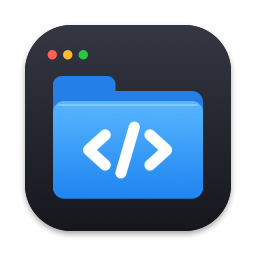

<div align="center">



# Open in VS Code

**Un clic droit dans le Finder, et ton dossier s'ouvre dans VS Code.**

[](https://github.com/latifcodess/OpenInVsCode/releases/latest)


[**⬇︎ Télécharger**](https://github.com/latifcodess/OpenInVsCode/releases/latest) · [Installation](#-installation) · [Fonctionnalités](#-fonctionnalités) · [Réglages](#%EF%B8%8F-réglages) · [Compiler soi-même](#%EF%B8%8F-compiler-depuis-les-sources)

</div>

---

## ✨ Fonctionnalités

- **« Ouvrir avec VS Code » dans le clic droit du Finder** : sur un fichier, un dossier, une sélection multiple, ou dans le vide d'une fenêtre pour ouvrir le dossier affiché.
- **Bouton dans la barre d'outils du Finder**, si tu préfères un clic plutôt qu'un menu.
- **Plusieurs éditeurs pris en charge** : VS Code, VS Code Insiders, Cursor et VSCodium. En mode automatique, l'app choisit celui qui est installé.
- **Petite fenêtre de réglages** pour adapter le comportement à ta façon de travailler.
- **Ouverture au démarrage** de la session, au choix.
- **Mises à jour automatiques** : l'app te prévient quand une nouvelle version sort et s'installe en un clic.

---

## 📦 Installation

### 1. Télécharger

Télécharge le fichier `OpenInVSCode-x.y.zip` depuis la [**dernière release**](https://github.com/latifcodess/OpenInVsCode/releases/latest), décompresse-le, puis glisse **Open in VS Code.app** dans ton dossier **Applications**.

### 2. Autoriser l'app au premier lancement

L'app est signée avec un certificat de développeur, mais **elle n'est pas notarisée par Apple** (ce qui demande un compte développeur payant). Au premier lancement, macOS va donc la bloquer avec un message du type :

> **« Open in VS Code » n'a pas été ouvert**
> Apple n'a pas pu confirmer que « Open in VS Code » ne contient pas de logiciel malveillant…

C'est normal, et ça ne se fait qu'une seule fois. Pour l'autoriser :

1. Clique sur **OK** (ou **Terminé**) pour fermer le message.
2. Ouvre les **Réglages Système** ( › Réglages Système…).
3. Va dans **Confidentialité et sécurité**.
4. **Descends tout en bas** de la page, jusqu'à la section **Sécurité**. Tu y verras la ligne *« Open in VS Code » a été bloqué afin de protéger votre Mac*.
5. Clique sur **Ouvrir quand même**.
6. Confirme avec ton mot de passe ou Touch ID, puis clique encore sur **Ouvrir quand même** dans la fenêtre qui s'affiche.

L'app s'ouvre, et macOS ne posera plus la question.

<details>
<summary>Alternative pour les habitués du Terminal</summary>

Cette commande retire le marqueur « téléchargé depuis Internet » de l'app, ce qui évite le blocage :

```sh
xattr -dr com.apple.quarantine "/Applications/Open in VS Code.app"
```

</details>

### 3. Activer l'extension Finder

À l'ouverture, l'app affiche sa fenêtre de réglages. Si la première ligne indique **Extension désactivée** :

1. Clique sur **Activer…**.
2. Dans les Réglages Système, coche **Open in VS Code** dans la liste des extensions du Finder.
   *(Chemin manuel : Réglages Système › Général › Éléments de connexion et extensions › Extensions du Finder.)*

C'est prêt : fais un clic droit sur un dossier dans le Finder 🎉

---

## 🖱️ Utilisation

| Où tu cliques | Ce qui s'ouvre |
|---|---|
| Clic droit sur un **dossier** | Le dossier dans l'éditeur |
| Clic droit sur un **fichier** | Le fichier (ou son dossier parent, selon les réglages) |
| Clic droit sur **plusieurs éléments** | Chaque élément sélectionné |
| Clic droit **dans le vide** d'une fenêtre | Le dossier affiché par la fenêtre |
| **Bouton de la barre d'outils** | La sélection, ou à défaut le dossier affiché |

> 💡 **Ajouter le bouton à la barre d'outils** : clic droit sur la barre d'outils d'une fenêtre du Finder › **Personnaliser la barre d'outils…**, puis glisse le bouton **Ouvrir dans l'éditeur** à l'endroit voulu.

---

## ⚙️ Réglages

Ouvre l'app **Open in VS Code** (depuis le Launchpad, Spotlight ou le dossier Applications) pour afficher ses réglages. Les changements s'appliquent immédiatement, sans redémarrer le Finder.

| Réglage | Effet |
|---|---|
| **Éditeur** | Automatique, VS Code, VS Code Insiders, Cursor ou VSCodium. Le menu du clic droit prend le nom de l'éditeur choisi. |
| **Toujours ouvrir dans une nouvelle fenêtre** | Ne réutilise jamais une fenêtre de l'éditeur déjà ouverte. |
| **Pour un fichier, ouvrir son dossier parent** | Pratique pour ouvrir tout le projet à partir de n'importe lequel de ses fichiers. |
| **Afficher l'icône de l'éditeur dans le menu** | Affiche ou masque la petite icône à côté de l'option du clic droit. |
| **Ouvrir au démarrage de la session** | Lance l'app discrètement à chaque démarrage pour vérifier les mises à jour, puis elle se ferme. |
| **Rechercher les mises à jour automatiquement** | Vérifie s'il existe une nouvelle version à chaque ouverture de l'app. |

---

## 🔄 Mises à jour

L'app vérifie les [releases GitHub](https://github.com/latifcodess/OpenInVsCode/releases) :

- **à chaque ouverture de l'app** ;
- **à chaque démarrage de la session**, si l'ouverture au démarrage est activée ;
- **à la demande**, avec le bouton **Rechercher maintenant** ou le menu **Open in VS Code › Rechercher les mises à jour…**.

Quand une nouvelle version existe, une alerte affiche les nouveautés et propose trois choix :

- **Installer et relancer** : l'app télécharge la nouvelle version, vérifie qu'elle est signée par le même développeur, se remplace et se rouvre toute seule.
- **Plus tard** : l'alerte reviendra à la prochaine vérification.
- **Ignorer cette version** : plus d'alerte automatique pour cette version.

Les mises à jour installées depuis l'app ne déclenchent pas le blocage de macOS décrit plus haut.

---

## 🛠️ Compiler depuis les sources

**Prérequis** : macOS 13 ou plus récent, Xcode, et [XcodeGen](https://github.com/yonaskolb/XcodeGen) (`brew install xcodegen`).

```sh
git clone https://github.com/latifcodess/OpenInVsCode.git
cd OpenInVsCode
./install.sh
```

`install.sh` génère le projet Xcode, compile en Release, installe l'app dans `/Applications`, active l'extension et relance le Finder.

> Le projet Xcode est généré à partir de [`project.yml`](project.yml). Modifie ce fichier plutôt que les réglages dans Xcode, puis lance `xcodegen generate`. Pour signer avec ton propre compte, remplace `DEVELOPMENT_TEAM` et l'identifiant d'App Group (`79W4JUNG7Y.…`) par les tiens.

### Publier une nouvelle version

```sh
./release.sh 1.2 "Ce qui change dans cette version"
```

Le script met à jour le numéro de version, compile, crée le zip, fait le commit, le tag et le push, puis publie la release GitHub. Les apps déjà installées proposeront la mise à jour à leur prochaine vérification.

---

## 🧩 Comment ça marche

```
Open in VS Code.app              ← app hôte (réglages, démarrage, mises à jour)
├── Contents/PlugIns/
│   └── FinderExtension.appex    ← extension Finder (menu du clic droit, bouton de barre d'outils)
└── Contents/Library/LaunchAgents/
    └── …LoginAgent.plist        ← lancement au démarrage de la session
```

| Dossier | Contenu |
|---|---|
| [`App/`](App) | App hôte en AppKit + SwiftUI : fenêtre de réglages, ouverture au démarrage, mises à jour |
| [`FinderExtension/`](FinderExtension) | Extension `FIFinderSync` : menus et bouton de barre d'outils |
| [`Shared/`](Shared) | Réglages et liste des éditeurs, partagés entre l'app et l'extension |

- L'extension Finder est **sandboxée** et n'a pas accès à tes fichiers. Elle ouvre l'éditeur via son lien `vscode://file/<chemin>`, qui ne transmet que le chemin.
- Les réglages sont partagés entre l'app et l'extension grâce à un **App Group**.
- L'ouverture au démarrage repose sur un **LaunchAgent** enregistré avec `SMAppService`.

---

## ❓ Dépannage

<details>
<summary><b>L'option n'apparaît pas dans le clic droit</b></summary>

1. Ouvre l'app et vérifie que la première ligne indique **Extension activée**. Sinon, clique sur **Activer…**.
2. Relance le Finder : maintiens <kbd>⌥ Option</kbd>, fais un clic droit sur l'icône du Finder dans le Dock, puis choisis **Relancer**.

</details>

<details>
<summary><b>Rien ne se passe quand je clique sur l'option</b></summary>

Vérifie que l'éditeur choisi dans les réglages est bien installé. En mode **Automatique**, l'app utilise le premier éditeur installé parmi VS Code, VS Code Insiders, Cursor et VSCodium.

</details>

<details>
<summary><b>macOS indique que l'app ne peut pas être ouverte</b></summary>

Suis l'étape [Autoriser l'app au premier lancement](#2-autoriser-lapp-au-premier-lancement).

</details>

<details>
<summary><b>Désinstaller l'app</b></summary>

1. Ouvre l'app et désactive **Ouvrir au démarrage de la session**.
2. Quitte l'app, puis mets **Open in VS Code.app** à la corbeille depuis le dossier Applications.

</details>

---

<div align="center">
<sub>Fait avec ❤️ en Swift · Open in VS Code n'est pas affilié à Microsoft.</sub>
</div>
